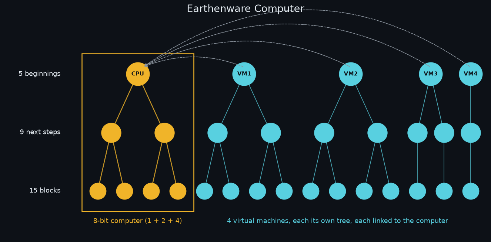

# Earthenware Computer

A ternary-style tree: **5 beginnings, 9 next steps, 15 blocks** (29 nodes). The first beginning's subtree is a real 8-bit computer; the other four are isolated virtual machines, each linked separately to the computer.



| Beginning | Steps | Blocks | Nodes |
|---|---|---|---|
| C (computer) | 2 | 4 | 7 |
| VM1 | 2 | 4 | 7 |
| VM2 | 2 | 4 | 7 |
| VM3 | 2 | 2 | 5 |
| VM4 | 1 | 1 | 3 |
| **Total: 5** | **9** | **15** | **29** |

Full structure: [`tree.json`](tree.json) (id, kind, level, parent, owner). Each VM links separately to `C`.

## Run (Python 3, stdlib only)

```
python3 main.py          # boot computer, run 4 VMs round-robin, print trace + host output
python3 -m unittest      # tests
```

## Computer tree -> 8-bit CPU (`cpu8.py`)

| Node | Level | Hardware |
|---|---|---|
| `C` | beginning | Control unit (fetch/decode/execute) |
| `C.alu` | step | ALU (ADD/SUB, mod-256 wrap, zero flag) |
| `C.mem` | step | Memory controller (256-byte memory) |
| `C.alu.a` | block | Register A (accumulator) |
| `C.alu.z` | block | Z flag register |
| `C.mem.pc` | block | PC register |
| `C.mem.io` | block | IO port: OUT buffer + VM links |

Instructions are 2 bytes (opcode, operand): `HALT LOAD addr, LDI imm, STORE addr, ADD addr, SUB addr, JMP addr, JZ addr, OUT, SEND [link], RECV [link]`. On the host the SEND/RECV operand is the VM id; RECV on an empty queue waits (PC does not advance).

## VMs (`vm.py`)

Each VM owns its tree nodes, a private `CPU8` (own memory + registers), and one `Link` (two queues) to the host. No memory is shared between VMs.

Demo: VM1 `200+100=44`, VM2 `10-20=246`, VM3 loop sum `5+4+3+2+1=15`, VM4 `255+1=0` → JZ → sends `42`. Host receives each, OUTs it, then OUTs the 8-bit sum: `HOST OUTPUT: [44, 246, 15, 42, 91]`.

## Absorbing products

`python3 absorb.py <owner/repo> [--entry CMD] [--vendor]` repackages an outside open-source project as an **Earthenware <Name>** product in its own VM slot.

1. Reads repo metadata + SPDX license via `gh api` (falls back to the public GitHub API with urllib).
2. **License gate:** only `MIT`, `Apache-2.0`, `BSD-2-Clause`, `BSD-3-Clause`, `ISC`. Anything else, or no license, is refused with a clear message and nothing is written.
3. Writes `products/<name>/`: `product.json` (name, upstream URL, pinned commit, license, entry command, VM slot), the upstream `LICENSE` copied unmodified, and a `NOTICE` crediting the original author, repo URL and commit.
4. **Pinned reference by default** — code is not vendored; the exact commit is recorded so it can be fetched reproducibly. `--vendor` additionally shallow-clones into `products/<name>/upstream/` (git-ignored).
5. Grows the tree: `tree.json` gains a `products` list and `product_links`. A hub node `P` (linked to `C`) roots a **ternary** tree of product VMs (`VM5`, `VM6`, … — max 3 children per parent, filled breadth-first), each linked to `C`. Products are kept out of `nodes` so the CPU demo tree stays at 29 nodes.

`vm.ProcessVM(vm_id, command, cwd)` runs a product's entry command as a subprocess in its own working dir; it talks to the host only via its `Link`: messages queued on `link.to_vm` become stdin lines, each stdout line becomes a `link.to_host` message.

Absorbed so far: `heatgate` (MIT) → Earthenware Heatgate, VM5; `llama.cpp` (MIT) → Earthenware Llama, VM6 (`llama-server`, model path placeholder — see products/llama.cpp/README.md); `valkey` (BSD-3-Clause) → Earthenware Valkey, VM7 (`valkey-server --port 0` + unix socket — see products/valkey/README.md). `mars-crawler` and `3xb-api` were refused (no license file) — add a permissive LICENSE upstream and re-run.
